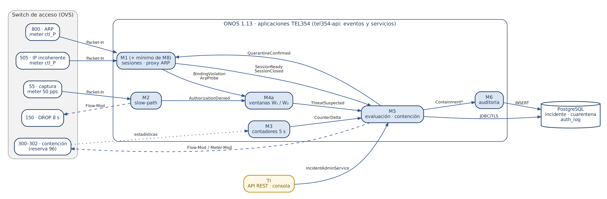
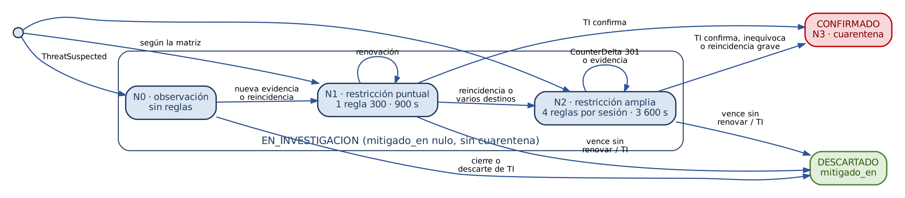
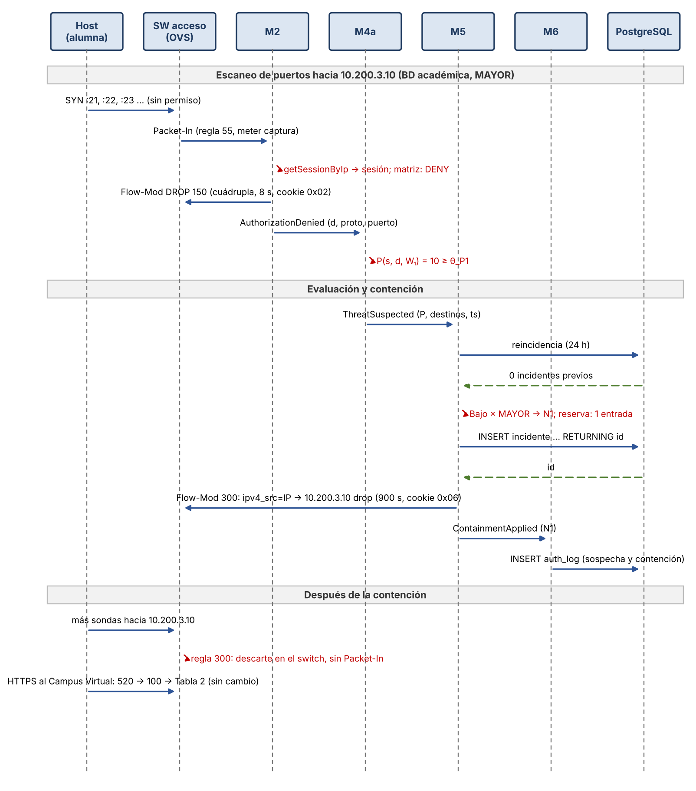

# 1. Introducción y alcance

Este documento desarrolla el diseño de bajo nivel (LLSD) del requisito **R3: detectar y mitigar ataques encubiertos en la intranet**. Parte del diseño de R3 del Informe Parcial (sección 2.3) y del LLSD de R1 y R2 (Avance 07), y lo lleva al nivel de implementación sobre ONOS 1.13:

- los módulos y su empaquetado como aplicaciones;
- los eventos y servicios que intercambian;
- las reglas OpenFlow con su tabla, prioridad, match, instrucciones, temporizador y cookie;
- las estructuras de datos de la detección y los algoritmos de evaluación y contención;
- el modelo de datos, la interfaz de TI y la configuración;
- el análisis cuantitativo y el plan de pruebas en la maqueta.

**R3** protege la intranet frente a usuarios que ya superaron R1 y R2: alumnos, docentes o equipos infectados con una sesión válida que escanean la red, suplantan direcciones o atacan en grupo un destino.

R3 no instala reglas para observar. Aprovecha que, con la denegación por defecto de R1 y R2, todo intento hacia un destino no autorizado y toda incoherencia de dirección ya suben al controlador por reglas existentes y acotadas por meters. La respuesta es gradual:

- mientras la sospecha está en investigación, el usuario conserva su rol, su VLAN y su IP, y solo se restringe su tráfico;
- la cuarentena (VLAN 999) se reserva para incidentes confirmados.

R4 y R5 se mencionan solo donde comparten recursos con R3: la reserva de mitigación, el meter de contención y el IDS.

## 1.1. Decisiones de diseño adoptadas

| ID | Decisión | Consecuencia en el diseño |
|---|---|---|
| R3-D1 | La solución principal es la detección por comportamiento sobre la denegación por defecto: R3 consume los Packet-In de las reglas 55 (R2), 505 (R1) y 800 (ARP), y los contadores de sus propias reglas. | No hay reglas de observación ni muestreo. La carga de R3 sobre ONOS está acotada por los meters existentes (sección 9). |
| R3-D2 | El IDS Suricata es un complemento. Este LLSD especifica su copia de tráfico y su interfaz de alertas, pero su implementación en la maqueta queda para después de validar la detección por comportamiento. | La validación de R3 en Mininet no depende del IDS. Las amenazas que solo ve el IDS (fuerza bruta contra un servicio y peticiones maliciosas) quedan especificadas y no se miden en esta etapa. |
| R3-D3 | Cada módulo es una aplicación de ONOS propia (M2, M3, M4a, M5 y M6, además de M1). Un bundle común, **tel354-api**, define los eventos y los servicios que comparten. | Fiel a la arquitectura M1–M8: cada app tiene su appId y su tipo de cookie. Los eventos cruzan bundles porque sus clases viven en un paquete exportado por tel354-api. |
| R3-D4 | Formato de cookie corregido: bits 63–48 = appId de ONOS, 47–40 = tipo, 39–8 = identificador, 7–0 = índice. | ONOS 1.13 deriva el appId de los 16 bits altos de la cookie (`appId = flowId >>> 48`). El formato de la Tabla 5 del Avance 07 haría que ONOS atribuyera las reglas a una app inexistente (sección 3.2). |
| R3-D5 | El Packet-In se distingue por su forma: IPv4 **con** VLAN → regla 55 de la Tabla 1 (lo atiende M2); IPv4 **sin** VLAN de una MAC con sesión → regla 505 (M1); ARP → regla 800 (M8). | Cada Packet-In tiene un único dueño y no se cuenta dos veces. No hace falta leer el table_id del Packet-In, que ONOS 1.13 no expone a las apps. |
| R3-D6 | M8 responde únicamente el ARP del gateway virtual 10.‹b›.0.1. Un ARP hacia cualquier otra dirección no recibe respuesta y genera el evento ArpProbe. | Un barrido ARP dentro del /12 del rol (nmap -sn) no ve hosts vivos y queda como evidencia de escaneo de red (métrica D). |
| R3-D7 | Dos ventanas deslizantes, W₁ = 10 s y W₂ = 600 s, con los umbrales de referencia del Informe Parcial (Tabla 28). En la maqueta, θ~F~ = 3. | Detecta desde escaneos agresivos (≤ 0,2 s) hasta nmap -T1 (≈ 450 s). Los umbrales se fijan después con la calibración $\theta = \max(\theta_0, \lceil \mu + k\sigma \rceil)$. |
| R3-D8 | Contención gradual N0–N2 con las reglas 300–302 de la Tabla 1. M5 administra por switch una reserva de 96 entradas, compartida con R4 por orden de llegada. | El peor caso del switch de acceso sigue en 1 989 entradas ≤ 2 000 (AVZ08, sección 3.6). Si una contención no cabe, la sesión queda en su nivel anterior y se notifica a TI. |
| R3-D9 | N3 (cuarentena) solo se aplica con confirmación: validación de TI, evidencia inequívoca (suplantación de un gateway, de la infraestructura o del plano de control) o reincidencia grave (tercer incidente Fuerte en 24 h). | Ninguna casilla de la matriz automática lleva a la VLAN 999; un falso positivo nunca sanciona. |
| R3-D10 | TI actúa sobre los incidentes con un único servicio, IncidentAdminService, expuesto de dos formas: la API REST `/onos/campus/v1/incidentes` (interfaz formal, para integrarse con herramientas de TI) y comandos de la consola de ONOS (operación local y demostración). | Las dos vías ejecutan el mismo código y M6 registra quién y por qué. Coincide con la práctica habitual: la integración se hace por la API northbound del controlador y la consola queda para el operador. |
| R3-D11 | M5 es dueño del meter contencion: lo crea en cada switch de acceso con MeterService al aplicar la primera contención N2. | Se retira ese meter de `onos_static.py`. M5 conoce su MeterId sin depender del orden de creación por REST. |
| R3-D12 | M5 tiene dos modos: ACTIVO (aplica la contención) y OBSERVACION (registra el incidente con el nivel calculado y no instala reglas). | Permite calibrar umbrales y correr la batería de R2, que intenta recursos no autorizados a propósito, sin contener a los usuarios de prueba. |
| R3-D13 | Los incidentes y las sanciones se guardan en PostgreSQL con un rol propio, onos_m5, por TLS. El estado de las ventanas vive solo en memoria de M4a. | Un reinicio de M4a pierde a lo sumo 10 min de conteo (W₂); los incidentes abiertos y sus contenciones se reconstruyen desde la base de datos y desde las reglas instaladas. |

*Tabla 1. Decisiones de diseño del LLSD de R3*

## 1.2. Requisitos previos en R1 y R2

El cotejo del diseño con el código validado en la maqueta encontró tres brechas que impiden observar a un atacante (P1 a P3) [y otros cambios que deben cerrarse antes de los módulos que los usan (Tabla 2). P8 surgió de la validación en modo automático del 19/10/2026.]{.mark}

| # | Diseño (Avance 07) | Estado en la maqueta | Cambio necesario | Bloquea |
|---|---|---|---|---|
| P1 | M8 no responde ARP entre usuarios | El proxy ARP responde con la MAC del gateway **cualquier** dirección consultada | Responder solo a 10.‹b›.0.1 y publicar ArpProbe en los demás casos | Métrica D por ARP |
| P2 | La regla 505 produce BindingViolation | El Packet-In IPv4 sin VLAN que no es DHCP se ignora | M1 publica BindingViolation (IP) con la IP usada y la concedida | Suplantación de IP |
| P3 | ARP con par (IP, MAC) incoherente → BindingViolation | Se descarta con un mensaje de depuración | M8 publica BindingViolation (ARP) | Suplantación ARP |
| P4 | Slow-path de la regla 55 en M2: DROP 150 y AuthorizationDenied | M2 no existe; los Packet-In de la regla 55 no los atiende nadie | App M2 (sección 5.3) | Métricas P, D, N y F |
| P5 | Eventos SessionReady, SessionClosed y operaciones de sesión | Solo existen en el log y en la tabla sesion | SessionService y eventos de M1 en tel354-api | Ciclo de vida de la contención |
| P6 | Revocación y paso forzado a cuarentena | No implementados | `revocar` y `aplicarCuarentena` en M1, con lease4-del en Kea | N3 |
| P7 | M6 escribe auth_log | No implementado | App M6 mínima (sección 5.7) | Evidencia para TI |
| [P8]{.mark} | [El rebote del puerto hace que el host reinicie 802.1X y DHCP (Avance 07, sección 7.7)]{.mark} | [Tras un rebote por expiración (1,5 s), wpa_supplicant no envió EAPOL-Start ni dhclient pidió IP: el host quedó sin acceso (fallo seguro)]{.mark} | [Al rehabilitar el puerto, M1 envía un EAP-Request/Identity; en la maqueta, `login.sh` registra una acción de `wpa_cli` que reinicia dhclient al completar 802.1X (sección 5.2)]{.mark} | [N3]{.mark} |

*Tabla 2. Cambios previos en R1 y R2 que necesita R3*

# 2. Amenazas, señales y métricas

## 2.1. Amenazas cubiertas

Para R3, la intranet es todo el espacio interno: los segmentos de usuarios (10.16.0.0 a 10.127.255.255), los servidores y servicios de 10.200.0.0/16 y el plano de control (172.16.0.0/16). El tráfico hacia y desde Internet corresponde a R5, y la inundación hacia un servidor autorizado, a R4.

| Amenaza | Definición operativa | Señal | Métrica | Herramienta de prueba |
|---|---|---|---|---|
| Escaneo de puertos | Un origen sondea muchos puertos distintos de un mismo destino no autorizado | Regla 55 → AuthorizationDenied | P(s, d, W) | nmap -sS / -sT |
| Escaneo de red | Un origen sondea muchos destinos internos distintos | Regla 55 → AuthorizationDenied; regla 800 → ArpProbe | D(s, W) | nmap -sn, barrido ICMP |
| Insistencia sobre recursos denegados | Un origen repite intentos hacia destinos que su rol no alcanza | Regla 55 → AuthorizationDenied | N(s, W₂) | scripts, clientes mal configurados |
| Ataque coordinado «todos a uno» | Varios orígenes intentan el mismo destino no autorizado | Regla 55 → AuthorizationDenied | F(d, W₂) | varios hosts a la vez |
| Suplantación de IP | Un host autenticado emite tráfico con una IP que no le fue concedida | Regla 505 → BindingViolation (IP) | evento único | hping3 --spoof |
| Suplantación ARP | Un host anuncia un par (IP, MAC) que no corresponde a su sesión | Regla 800 → BindingViolation (ARP) | evento único | arpspoof, scapy |
| Fuerza bruta contra un servicio interno | Conexiones repetidas a un servicio autorizado, probando credenciales | IDS sobre la copia del puerto T | alerta del IDS | hydra (implementación posterior) |
| Peticiones maliciosas hacia un servidor autorizado | Contenido con firma conocida en un servicio en texto claro | IDS sobre la copia del puerto T | alerta del IDS | sqlmap (implementación posterior) |

*Tabla 3. Amenazas de R3, señales y métricas*

## 2.2. Métricas de detección

M4a calcula las métricas de la Tabla 4 sobre las ventanas W₁ y W₂. Se añade la métrica P, que el Informe Parcial usa en sus Tablas 24, 28, 51 y 53, pero no define en su Tabla 23.

| Métrica | Definición | Elemento que cuenta | Ventanas |
|---|---|---|---|
| P(s, d, W) | Puertos de destino distintos que la sesión s intentó sin permiso hacia el destino d | par (d, puerto) | W₁ y W₂ |
| D(s, W) | Destinos internos distintos que s intentó sin permiso, por IP (regla 55) o por ARP (ArpProbe) | destino d | W₁ y W₂ |
| N(s, W₂) | Eventos AuthorizationDenied de s; como el DROP 150 dura 8 s, un intento repetido aporta a lo sumo un evento cada 8 s | evento | W₂ |
| F(d, W₂) | Sesiones distintas que intentaron sin permiso el destino d | origen s | W₂ |
| Suplantación | Paquete con una IP no concedida, o ARP con un par (IP, MAC) incoherente | evento | — (umbral 1) |

*Tabla 4. Métricas de detección de R3*

P, D y F cuentan **elementos distintos**, no paquetes. Por eso las retransmisiones y los reintentos hacia el mismo servicio no las inflan, y un usuario legítimo que se equivoca de URL o de puerto queda con P y D en 1 o 2.

| Ventana | θ~P~ | θ~D~ | θ~N~ | θ~F~ | Tasa mínima detectable | Uso |
|---|---|---|---|---|---|---|
| W₁ = 10 s | 10 | 8 | — | — | 1 sonda/s | Escaneos de temporización normal o agresiva (nmap -T2 a -T5) |
| W₂ = 600 s | 30 | 24 | 30 | 5 (3 en la maqueta) | 0,05 sondas/s | Escaneos lentos (nmap -T1), insistencia y ataques coordinados |

*Tabla 5. Ventanas y umbrales de referencia*

# 3. Arquitectura de los módulos de R3

## 3.1. Aplicaciones y responsabilidades

La Figura 1 muestra las aplicaciones de ONOS que intervienen en R3, los eventos que intercambian y las reglas que originan cada señal. La Tabla 6 resume la responsabilidad de cada una.

{width=6.2in}

*Figura 1. Módulos de R3 sobre ONOS 1.13: aplicaciones, eventos y fuentes en el plano de datos*

| Bundle o app | appId | Tipo de cookie | Función en R3 | Servicios de ONOS que usa | Rol de BD |
|---|---|---|---|---|---|
| tel354-api (bundle) | — | — | Interfaces y eventos compartidos: SessionService, AuthorizationEvent, ThreatEvent, IncidentService, IncidentAdminService, MitigationReserveService | — | — |
| M1 · tel354.m1 (con el mínimo de M8) | tel354.m1 | 0x02 | BindingViolation (IP y ARP), ArpProbe, SessionReady y SessionClosed; revocación y paso forzado a cuarentena | PacketService, FlowRuleService, DeviceAdminService | onos_m1 |
| M2 · tel354.m2 | tel354.m2 | 0x02 (DROP 150) | Slow-path de la regla 55: DROP 150 y AuthorizationDenied | PacketService, FlowRuleService | onos_m2 |
| M3 · tel354.m3 | tel354.m3 | — | Lectura de contadores cada 5 s de las reglas vigiladas (regla 301 de N2) | FlowRuleService (estadísticas) | — |
| M4a · tel354.m4a | tel354.m4a | — | Ventanas deslizantes; publica ThreatSuspected | — | — |
| M5 · tel354.m5 | tel354.m5 | 0x06 | Evaluación, contención N0–N2, reserva de mitigación, confirmación N3; API REST y comandos de TI | FlowRuleService, MeterService | onos_m5 |
| M6 · tel354.m6 | tel354.m6 | — | Registro en auth_log de todos los eventos de R3 | — | onos_m6 |

*Tabla 6. Aplicaciones de ONOS de R3*

Cada app declara en su `pom.xml` la dependencia de tel354-api y, en `onos.app.requires`, las apps cuyos servicios consume: M2, M4a y M5 requieren tel354.m1, y M5 requiere además tel354.m3.

## 3.2. Formato de la cookie

ONOS 1.13 construye el identificador de cada regla a partir de la cookie y asigna la regla a la app indicada por sus 16 bits altos (`DefaultFlowRule`: `appId = (short)(flowId >>> 48)`). Si esos bits no contienen el appId, la regla no aparece en `getFlowEntriesById(appId)` y su app no la reconoce como propia. [Por eso el formato inicial del Avance 07 (tipo en los bits 63–56) se reemplazó por el de la Tabla 7, que M1 ya usa en la maqueta; el Avance 07 y el Informe Parcial ya lo incorporan.]{.mark}

| Bits 63–48 | Bits 47–40 | Bits 39–8 | Bits 7–0 | Reglas |
|---|---|---|---|---|
| appId de la app dueña | 0x01 régimen base | identificador de la regla base | 0 | 900, 800, 600, 10 |
| appId de M1 | 0x02 sesión | sesion.id | índice: 0 = 525, 1 = 505, 2 = 520, 3 = 200, 4 = 190, 5… = 110 | Reglas de la sesión |
| appId de M2 | 0x02 sesión | sesion.id | contador cíclico (0–255) | DROP 150 |
| appId de M2 | 0x03 rol | recurso.id | código de rol k | Permisos 100 |
| appId de M2 | 0x04 común | identificador de la regla | 0 | 60, 58, 57, 55, 50, 0 |
| appId de M8 | 0x05 camino | identificador del camino | 0 | Tabla 2 fija y core |
| appId de M5 | 0x06 contención | incidente.id | índice: 0 = 300 (N1); en N2, 0 = 300, 1 y 2 = 301, 3 = 302, por sesión | 300–302 |
| appId de M5 | 0x07 mitigación | identificador de la mitigación | índice | 910, 120, 350 (R4) |

*Tabla 7. Estructura de la cookie OpenFlow [(la misma de la Tabla 5 del Avance 07 y la Tabla 4 del Informe Parcial, ya corregidas)]{.mark}*

Con 32 bits, el identificador admite 4 294 967 295 sesiones o incidentes antes de repetirse. A la tasa de diseño, unas 7 020 sesiones por día (AVZ08, Tabla 16), eso equivale a más de 1 600 años.

$$\text{cookie} = \text{appId}\cdot 2^{48} + \text{tipo}\cdot 2^{40} + \text{id}\cdot 2^{8} + \text{índice}$$

## 3.3. Servicios compartidos

tel354-api exporta las interfaces de la Tabla 8. Cada app registra su implementación como servicio OSGi (`@Service`) y las demás la obtienen con `@Reference`.

| Servicio | Implementa | Operaciones | Usan |
|---|---|---|---|
| SessionService | M1 | `getSessionByIp(Ip4Address)`, `getSessionsByUser(int)`, `getSession(long)`, `revocar(long sesionId, Motivo, String solicitante)`, `aplicarCuarentena(int usuarioId, long incidenteId)`, `addListener(SessionListener)` | M2, M4a, M5, M6 |
| AuthorizationService | M2 | `addListener(AuthorizationListener)` | M4a, M6 |
| ThreatService | M4a | `addListener(ThreatListener)`, `estado(long sesionId)` | M5, M6 |
| CounterService | M3 | `vigilar(FlowId, DeviceId)`, `dejarDeVigilar(FlowId)`, `addListener(CounterListener)` | M5 |
| MitigationReserveService | M5 | `reservar(DeviceId, int entradas, Requisito)`, `liberar(DeviceId, int)`, `libres(DeviceId)` | M5 (R3), R4 |
| IncidentService | M5 | `addListener(IncidentListener)`, `abiertos(int usuarioId)` | M1, M6 |
| IncidentAdminService | M5 | `listar(Filtro)`, `detalle(long)`, `confirmar(long, Duration sancion, String solicitante, String motivo)`, `descartar(long, String solicitante, String motivo)`, `modo(Modo)` | API REST, comandos de consola |

*Tabla 8. Servicios del bundle tel354-api*

> // tel354-api: evento de sesión (patrón AbstractEvent de ONOS)
>
> public class SessionEvent extends AbstractEvent<SessionEvent.Type, SesionInfo> {
>
> public enum Type { SESSION_READY, SESSION_CLOSED, AUTH_FAILED, BINDING_VIOLATION, ARP_PROBE }
>
> // SesionInfo: id, usuarioId, rol, mac, dpid, puerto, ip, vlan
>
> // detalle: ipUsada, ipConcedida, ipBuscada, motivoCierre (según el tipo)
>
> }

## 3.4. Eventos

| Evento | Emisor | Suscriptores | Momento | Campos |
|---|---|---|---|---|
| SessionReady | M1 | M5, M6 | Binding 520 instalado | sesión completa |
| SessionClosed | M1 | M2, M5, M6 | Cierre por cualquier motivo | sesión, motivo |
| BindingViolation (IP) | M1 | M4a, M6 | Packet-In de la regla 505 con sesión ACTIVA | sesión, ipUsada, ipConcedida, ts |
| BindingViolation (ARP) | M8 (en M1) | M4a, M6 | ARP con emisor distinto de la IP de la sesión | sesión, ipAnunciada, mac, ts |
| ArpProbe | M8 (en M1) | M4a | ARP de una sesión ACTIVA hacia una IP que no es su gateway | sesión, ipBuscada, ts |
| AuthorizationDenied | M2 | M4a, M6 | DROP 150 instalado | sesión, ipDst, proto, puertoDst, dpid, ts |
| ThreatSuspected | M4a | M5, M6 | Una métrica alcanza su umbral o llega una suplantación | sesión, métrica, valor, umbral, ventana, destinos, ts primera evidencia, ts umbral |
| CounterDelta | M3 | M5 | Lectura con aumento del contador de una regla vigilada | flowId, dpid, Δpaquetes, intervalo |
| ContainmentApplied / ContainmentLifted | M5 | M1, M6 | Cambio de nivel N0–N2 o cierre del incidente | incidente, sesiones, nivel, expira_en |
| QuarantineConfirmed | M5 | M1, M6 | Sanción insertada en cuarentena | incidente, usuario, fin de la sanción |
| IdsAlert (posterior) | API REST | M4a, M6 | Alerta de Suricata | firma, prioridad, origen, destino, puerto |

*Tabla 9. Eventos que intervienen en R3*

Los listeners de ONOS se ejecutan en un hilo de entrega de eventos que no debe bloquearse. Cada app atiende sus eventos en un ejecutor propio de un solo hilo, como M1 en la maqueta, de modo que las consultas JDBC y los Flow-Mod no detienen al resto del controlador y el orden de los eventos de una misma app se conserva.

# 4. Pipeline OpenFlow de R3

## 4.1. Reglas que R3 reutiliza

R3 no instala reglas para observar. Las señales provienen de reglas que ya existen por R1 y R2 (Tabla 10).

| Tabla | Prio | Regla | Señal para R3 | Límite de Packet-In |
|---|---|---|---|---|
| 0 | 800 | ARP del puerto P → CONTROLLER | ArpProbe y BindingViolation (ARP) | meter ctl_P: 10 pps, ráfaga 10, por puerto |
| 0 | 505 | IPv4 de la MAC de la sesión con IP distinta → CONTROLLER | BindingViolation (IP) | meter ctl_P |
| 1 | 55 | IPv4 hacia 10.0.0.0/8 o 172.16.0.0/16 sin permiso → CONTROLLER | AuthorizationDenied (vía M2) | meter captura: 50 pps, ráfaga 20, por switch |
| 1 | 150 | DROP de la cuádrupla denegada, 8 s | Evita contar dos veces el mismo intento | — |
| Todos | — | Techo del canal de control | — | 200 pps por switch de acceso |

*Tabla 10. Reglas existentes que generan la evidencia de R3*

## 4.2. Reglas de contención

M5 instala las reglas de la Tabla 11 en la Tabla 1 del switch de acceso de cada sesión contenida. Su prioridad supera a los permisos 100 y 110, al DROP 150 y a la limitación 120 de R4, porque deben poder restringir tráfico que la política sí autoriza.

| Prio | Nivel | Match | Instrucciones | Timeout | Cookie (índice) |
|---|---|---|---|---|---|
| 302 | N2 | eth_type=0x0800, ipv4_src=IP/32, ipv4_dst=10.200.0.14/32, ip_proto=17, udp_dst=53 | goto_table:2 | hard = 3 600 s | 0x06 (3) |
| 301 | N2 | eth_type=0x0800, ipv4_src=IP/32, ipv4_dst=10.0.0.0/8 | drop | hard = 3 600 s | 0x06 (1) |
| 301 | N2 | eth_type=0x0800, ipv4_src=IP/32, ipv4_dst=172.16.0.0/16 | drop | hard = 3 600 s | 0x06 (2) |
| 300 | N2 | eth_type=0x0800, ipv4_src=IP/32 | meter:contencion; goto_table:2 | hard = 3 600 s | 0x06 (0) |
| 300 | N1 | eth_type=0x0800, ipv4_src=IP/32, ipv4_dst=D/32 [, ip_proto, tcp_dst \| udp_dst] | drop | hard = 900 s | 0x06 (0) |

*Tabla 11. Reglas de contención de R3 (Tabla 1 del switch de acceso)*

El match de N1 depende del tipo de ataque:

- escaneo de puertos: solo el destino, porque el atacante ya mostró interés en cualquier puerto;
- insistencia y ataque coordinado: el destino, el protocolo y el puerto intentados;
- escaneo de red: no usa N1, porque no tiene un único destino; M5 aplica N2.

Una regla 300 de N1 y una de N2 nunca coexisten en la misma sesión: al pasar de N1 a N2, M5 retira por cookie las reglas N1 de todas las sesiones del usuario y luego instala las de N2, en dos etapas de una misma FlowRuleOperations.

## 4.3. Meters

| Meter | Switch | Tipo | Banda | Reglas | Dueño |
|---|---|---|---|---|---|
| ctl_P (uno por puerto) | Acceso | pktps | drop, 10 pps, ráfaga 10 | 800, 525, 505 | M7 (en la maqueta, `onos_static.py`) |
| captura | Acceso | pktps | drop, 50 pps, ráfaga 20 | 55 | M2 (en la maqueta, `onos_static.py`) |
| contencion | Acceso | kbps | drop, 1 000 kbps, burstSize obligatorio | 300 (N2) | **M5**, creado con MeterService en la primera contención N2 del switch |

*Tabla 12. Meters que usa R3*

El meter contencion es uno por switch: las sesiones en N2 de un mismo switch comparten 1 Mbps hacia Internet.

## 4.4. Reserva de mitigación

Tras las reglas de R1, R2 y el DROP 150, el switch de acceso conserva 96 entradas para la mitigación (AVZ08, sección 3.6). M5 las administra con MitigationReserveService, un contador por switch protegido por exclusión mutua y compartido con R4. El costo de cada contención es:

$$e(\text{N1}) = 1, \qquad e(\text{N2}) = 4 \text{ por sesión}, \qquad \sum_{\text{switch}} e \le M_{\max} = 96$$

El algoritmo de reserva es el siguiente:

1. Antes de instalar, M5 calcula las entradas netas: las nuevas menos las que retira en la misma operación (por ejemplo, N1 → N2 libera 1 y reserva 4).
2. Si `libres(switch) ≥ netas`, reserva y aplica. Si no, la sesión queda en su nivel anterior, el incidente registra `evidencia.reserva_llena = true` y se notifica a TI.
3. La reserva se libera cuando la regla desaparece: retiro por M5, FLOW_REMOVED por hard_timeout o cierre de la sesión.
4. Al arrancar, M5 reconstruye el contador desde las reglas de su appId presentes en cada switch (`getFlowEntriesById`).

R4 usa el mismo servicio para las reglas 910 y 120, por orden de llegada; si hay más candidatas que espacio, R4 limita primero a las de mayor tasa.

## 4.5. Temporizadores y retiro

| Regla | Temporizador | Retiro anticipado | Renovación |
|---|---|---|---|
| 300 (N1) | hard = 900 s | Descarte del incidente; paso a N2; cierre de la sesión; confirmación (N3) | Nueva evidencia del mismo incidente antes del vencimiento |
| 300–302 (N2) | hard = 3 600 s | Descarte; cierre de la sesión; confirmación (N3) | El contador de la regla 301 aumentó en el último periodo de M3 (el ataque persiste) o llega nueva evidencia |
| DROP 150 (M2) | hard = 8 s | Cierre de la sesión (cookie 0x02 con el appId de M2) | No se renueva: el siguiente intento vuelve al slow-path |

*Tabla 13. Temporizadores de las reglas de R3*

**Renovación.** Una regla OpenFlow no permite extender su hard_timeout. M5 la renueva con una FlowRuleOperations de dos etapas: en la primera retira la regla y en la segunda la instala con un nuevo hard_timeout. Durante el intervalo entre ambas, del orden de un Flow-Mod (≈ 1 ms), el tráfico hacia destinos no autorizados sigue negado por la captura 55 y el DROP 150. Solo el tráfico hacia un destino autorizado restringido por N1 podría pasar en ese milisegundo.

**Vencimiento.** M5 escucha FlowRuleEvent.RULE_REMOVED de sus reglas. Cuando vencen todas las reglas de un incidente sin renovación, M5 publica ContainmentLifted, registra mitigado_en y libera la reserva. Si el controlador cae, las contenciones vencen solas en el switch: nunca quedan reglas huérfanas.

# 5. Diseño detallado por módulo

## 5.1. M8 mínimo (en M1): ARP del gateway y ArpProbe

En la maqueta, el proxy ARP de M8 está dentro de M1. Para cada trama ARP recibida por la regla 800, sea solicitud o respuesta:

> s ← sesión por (dpid, puerto, MAC origen)
>
> si s es nula o s.estado ≠ ACTIVA: descartar sin respuesta // aún sin IP, o equipo sin sesión
>
> si emisor = 0.0.0.0: descartar sin respuesta // sondeo de DHCP
>
> si emisor ≠ s.ip: publicar BindingViolation(ARP, s, emisor); descartar // incluye respuestas y ARP gratuitos falsos
>
> si es una respuesta, o emisor = buscado: descartar sin respuesta // ARP gratuito o respuesta con su propia IP
>
> si buscado = gateway(s) = 10.‹b›.0.1: responder con 02:00:00:00:00:‹b›
>
> si no: publicar ArpProbe(s, buscado); no responder

La comprobación del emisor va antes que la del ARP gratuito, porque la suplantación clásica (arpspoof) envía respuestas o ARP gratuitos que anuncian la IP del gateway con la MAC del atacante.

La rama del gateway es la única que responde. Así, un `nmap -sn` dentro del /12 del rol no descubre ningún host. Una consulta legítima hacia otra IP del rol no ocurre en la operación normal: el host solo alcanza destinos fuera de su subred por el gateway, y los demás usuarios de su /12 no tienen ningún servicio para él.

Si el emisor anuncia la IP de un gateway virtual (10.‹b›.0.1), de un servidor de 10.200.0.0/24 o del plano de control, el evento lleva la marca `inequivoca = true`.

## 5.2. M1: BindingViolation, revocación y paso forzado

**Suplantación de IP.** Un Packet-In IPv4 **sin** etiqueta VLAN que llega de un puerto de acceso solo puede venir de la regla 525 (DHCP) o de la 505. Si no es DHCP y la sesión de (dpid, puerto, MAC) está ACTIVA, M1 publica BindingViolation (IP) con la IP de origen usada y la concedida. Si la sesión está AUTENTICADA, solo lo descarta, como fija el Avance 07. La IP usada lleva `inequivoca = true` en los mismos casos que la sección 5.1.

**Revocación.** `revocar(sesionId, motivo, solicitante)` cierra la sesión (REVOCACION), retira sus reglas por cookie, publica SessionClosed y rebota el puerto con DeviceAdminService, sin bloquear el hilo de eventos.

**Paso forzado a cuarentena.** Al recibir QuarantineConfirmed, M1 ejecuta para cada sesión activa del usuario:

1. cierre con motivo CUARENTENA y retiro de reglas por cookie;
2. `lease4-del` de su IP en Kea, por el Control Agent (POST a http://10.200.0.13:8000, servicio dhcp4);
3. rebote del puerto con t~down~ = 5 s [y, al rehabilitarlo, un EAP-Request/Identity hacia el host (P8).]{.mark}

Al reautenticarse, FreeRADIUS encuentra la sanción y devuelve el rol Cuarentena; Kea responde DHCPNAK a la IP anterior y entrega una de 10.‹112+N›.0.0/16 en la VLAN 999 (Avance 07, sección 7.7). La network config de M1 añade `keaCtrlUrl`.

[**Reautenticación tras el rebote (P8).** En la maqueta (19/10/2026), después de un rebote por expiración, el host no reinició 802.1X ni DHCP: conservó su IP sin sesión y sin conectividad. El fallo es seguro, pero el paso a la VLAN 999 no se completaría. Por eso, al rehabilitar el puerto, M1 envía por Packet-Out una trama EAPOL de tipo EAP-Packet con un EAP-Request/Identity hacia 01:80:C2:00:00:03, que es la autenticación iniciada por el autenticador de IEEE 802.1X: el supplicant la responde aunque se considere autenticado. Si no hay respuesta en 30 s, M1 la repite hasta 3 veces y luego deja el puerto cerrado. En la maqueta, `login.sh` registra además una acción de `wpa_cli` que, al completarse 802.1X, libera y vuelve a pedir la dirección con dhclient, como haría un cliente real al recuperar el enlace; así el host recibe la IP de Cuarentena.]{.mark}

## 5.3. M2: slow-path de la regla 55

M2 registra un PacketProcessor que atiende solo tramas IPv4 **con** etiqueta VLAN recibidas de un puerto de acceso (R3-D5).

> s ← SessionService.getSessionByIp(ipv4_src)
>
> si s es nula o (dpid, puerto) ≠ (s.dpid, s.puerto): descartar // no corresponde a una sesión válida
>
> (proto, dport) ← TCP o UDP: (6 o 17, puerto destino); ICMP u otro: (proto, —)
>
> si la matriz en caché permite (s.rol, s.cursos, ipv4_dst, proto, dport): reinstalar el permiso y Packet-Out // carrera con un cambio de política
>
> si no:
>
> instalar DROP 150: ipv4_src=s.ip, ipv4_dst, ip_proto [, tcp_dst | udp_dst], hard = 8 s, cookie (M2, 0x02, s.id, n)
>
> publicar AuthorizationDenied(s, ipv4_dst, proto, dport, dpid)

En ICMP el DROP 150 no lleva puerto, de modo que un barrido ICMP produce un evento por destino, que suma en D. Mientras el DROP de una cuádrupla está vigente, sus repeticiones se descartan en el switch y no llegan a M2: un intento repetido aporta a lo sumo un evento cada 8 s, propiedad en la que se apoya N (Informe Parcial, sección 2.3.5).

Al recibir SessionClosed, M2 retira por cookie los DROP 150 de esa sesión, para que no afecten a otro usuario que reciba la misma IP.

## 5.4. M3: lectura de contadores

M3 recorre cada P = 5 s las entradas de su lista de vigilancia con `FlowRuleService.getFlowEntries(deviceId)` y compara `packets()` con la lectura anterior. Si aumentó, publica CounterDelta. En R3, M5 pide vigilar la regla 301 (índice 1, destino 10.0.0.0/8) de cada sesión en N2: un aumento indica que el usuario sigue intentando destinos internos, aunque el switch los descarte sin Packet-In.

La lectura de estadísticas la hace ONOS de todos modos (proveedor OpenFlow, sondeo periódico de flujos), de modo que M3 lee del almacén de ONOS y no envía mensajes extra a los switches. El periodo de sondeo del proveedor debe ser de 5 s, el valor por defecto de ONOS 1.13; se comprueba en la consola:

> cfg get org.onosproject.provider.of.flow.impl.OpenFlowRuleProvider flowPollFrequency

## 5.5. M4a: ventanas deslizantes

**Estructuras.** M4a mantiene en memoria las estructuras de la Tabla 14. Cada elemento guarda la marca de tiempo de su última aparición; al consultar una métrica se descartan los elementos con más antigüedad que la ventana (purga perezosa), y un temporizador de 60 s elimina las entradas vacías.

| Estructura | Clave | Contenido | Tope por clave |
|---|---|---|---|
| destinos[s] | sesión s | mapa d → último instante | θ~D2~ = 24 destinos |
| puertos[s][d] | sesión s y destino d | mapa (proto, puerto) → último instante | θ~P2~ = 30 pares |
| eventos[s] | sesión s | cola de instantes de AuthorizationDenied | θ~N~ = 30 instantes |
| origenes[d] | destino d | mapa s → último instante | θ~F~ = 5 sesiones |
| alertadas | (s o d, métrica, ventana) | instante del último ThreatSuspected | 1 por clave |

*Tabla 14. Estructuras de M4a*

Los topes acotan la memoria: al alcanzar el umbral, la estructura ya no necesita crecer, porque la alarma se dispara y M5 agrega la evidencia siguiente al mismo incidente.

**Procesamiento de un evento.** Cada evento se procesa en O(1) amortizado:

> AuthorizationDenied(s, d, proto, dport):
>
> agregar d a destinos[s]; agregar (proto, dport) a puertos[s][d]; agregar ts a eventos[s]; agregar s a origenes[d]
>
> para W en {W₁, W₂}: evaluar P(s, d, W), D(s, W); evaluar N(s, W₂) y F(d, W₂)
>
> ArpProbe(s, ip): agregar ip a destinos[s]; evaluar D(s, W₁) y D(s, W₂)
>
> BindingViolation(s, …): publicar ThreatSuspected(SUPLANTACION) de inmediato
>
> SessionClosed(s): eliminar destinos[s], puertos[s] y eventos[s]

**Publicación.** Al alcanzar un umbral, M4a publica ThreatSuspected con la sesión, la métrica, su valor, el umbral, la ventana, los destinos implicados (con sus puertos) y los instantes de la primera evidencia y del umbral. Para no repetir la misma alarma, una clave (s, métrica, ventana) no vuelve a publicarse durante una ventana completa; la evidencia nueva de ese periodo se envía como ThreatSuspected de **actualización**, que M5 agrega al incidente abierto.

M4a no usa PacketObserved: los Packet-In que este evento resume son los mismos que ya llegaron como AuthorizationDenied, y contarlos otra vez duplicaría la evidencia.

## 5.6. M5: evaluación, contención y confirmación

**Evaluación.** Por cada ThreatSuspected nuevo:

1. **Nivel de ataque** según el tipo (Tabla 15).
2. **Criticidad** del destino por el prefijo más específico de la configuración (Avance 07, Tabla 25). Con varios destinos se toma la mayor; sin destino identificable, MAYOR.
3. **Nivel de contención** por la matriz de la Tabla 16.
4. **Ajustes:**
   - un segundo incidente del usuario en 24 h sube un nivel, hasta N2;
   - si resulta N1 y el ataque no tiene un único destino, se aplica N2;
   - un ataque coordinado cuyos orígenes solo intentaron el puerto de servicio de un recurso inventariado se evalúa como Bajo.
5. **Confirmación automática** si la evidencia es inequívoca o hay reincidencia grave: tercer incidente Fuerte del usuario en 24 h, con las contenciones anteriores ya vencidas.

| Métrica o evento | Tipo de ataque (tipo_ataque) | Nivel de ataque |
|---|---|---|
| P | ESCANEO_PUERTOS | Bajo |
| D | ESCANEO_RED | Bajo |
| N | ACCESO_REITERADO | Bajo |
| F | ATAQUE_COORDINADO | Intermedio (Bajo con la excepción del paso 4) |
| BindingViolation (IP o ARP) | SUPLANTACION | Fuerte |
| IdsAlert (posterior) | FUERZA_BRUTA_SERVICIO, PETICION_MALICIOSA, FIRMA_MALICIOSA | Intermedio o Fuerte, según la firma |

*Tabla 15. Tipo de ataque y nivel*

| Nivel de ataque | MENOR | MAYOR | CRÍTICO |
|---|---|---|---|
| Bajo | N0 | N1 | N1 |
| Intermedio | N1 | N1 | N2 |
| Fuerte | N2 | N2 + revisión prioritaria | N2 + revisión prioritaria |

*Tabla 16. Nivel de contención (igual a la Tabla 27 del Avance 07)*

**Agregación.** Si la sesión ya tiene un incidente abierto del mismo tipo, la nueva evidencia se agrega a su columna evidencia y se reevalúa el nivel. Si no, se abre otro. En un ataque coordinado se abre un incidente por cada sesión de origen.

**Aplicación.** En modo ACTIVO, M5:

1. inserta el incidente (`INSERT … RETURNING id`), que da el identificador de la cookie 0x06;
2. reserva las entradas (sección 4.4) en el switch de cada sesión afectada (N1: la sesión de origen; N2: todas las sesiones del usuario);
3. instala las reglas de la Tabla 11 en una FlowRuleOperations;
4. publica ContainmentApplied.

En modo OBSERVACION solo registra el incidente con `accion = N0` y el nivel calculado en `evidencia.nivel_calculado`.

**Ciclo de vida.**

- **SessionClosed:** M5 retira las reglas 0x06 de la sesión cerrada; el incidente sigue abierto.
- **SessionReady del mismo usuario con un incidente abierto:** M5 aplica de inmediato la contención vigente a la sesión nueva, de modo que reconectarse no sirve para eludirla.
- **CounterDelta de la regla 301:** renueva N2 por otros 3 600 s.
- **Vencimiento sin renovación:** ContainmentLifted.

La Figura 2 resume los estados.

{width=5.6in}

*Figura 2. Estados del incidente y de la contención en M5*

**Confirmación y descarte.** `confirmar(id, sancion, solicitante, motivo)`:

1. retira las reglas 0x06 del incidente;
2. inserta en cuarentena (usuario, incidente, inicio = now(), fin = now() + sanción);
3. actualiza accion = N3 y publica QuarantineConfirmed, que dispara el paso forzado de M1.

El orden es obligatorio: la fila de cuarentena debe existir antes de que el host se reautentique.

`descartar(id, …)` retira las reglas, registra mitigado_en y publica ContainmentLifted.

La duración de la sanción la fija TI al confirmar (referencia: 24 h; la sección 3.3 del Avance 07 limita el Session-Timeout de Cuarentena a 43 200 s y renueva la sanción en cada reautenticación).

## 5.7. M6: registro de auditoría

M6 se suscribe a todos los eventos de la Tabla 9 y a las operaciones de IncidentAdminService, y los inserta en auth_log con el rol onos_m6 (solo INSERT). Escribe en lotes cada 1 s, o al acumular 100 filas, desde su propio ejecutor, de modo que una ráfaga de eventos no bloquea a los demás módulos. Un fallo de la base de datos retiene hasta 10 000 filas en memoria y luego descarta las más antiguas, registrando cuántas perdió.

| Evento | auth_log.evento | Referencias | detalle (JSONB) |
|---|---|---|---|
| AuthorizationDenied | AUTORIZACION_DENEGADA | sesion_id, usuario_id, dispositivo_id | ip_dst, proto, puerto, dpid |
| BindingViolation | SUPLANTACION | sesion_id, usuario_id, dispositivo_id | tipo (IP o ARP), ip_usada, ip_concedida, inequivoca |
| ThreatSuspected | SOSPECHA | sesion_id, usuario_id | métrica, valor, umbral, ventana, destinos |
| ContainmentApplied / Lifted | CONTENCION_APLICADA / CONTENCION_RETIRADA | sesion_id, usuario_id | incidente_id, nivel, expira_en, motivo |
| QuarantineConfirmed | CUARENTENA | usuario_id | incidente_id, fin, solicitante, motivo |
| Operación de TI | ADMIN_INCIDENTE | usuario_id | operación, incidente_id, solicitante, vía (REST o consola) |

*Tabla 17. Registro de R3 en auth_log*

ArpProbe no se registra uno por uno, porque un barrido produciría una fila por dirección. Su efecto queda en la evidencia del incidente: la lista de destinos y su conteo.

## 5.8. Interfaz de TI

TI consulta y resuelve los incidentes con IncidentAdminService, por dos vías que ejecutan el mismo código (R3-D10).

**API REST.** Es la interfaz formal: la usan herramientas de TI (un SIEM, un tablero o scripts) y es el punto de entrada de las alertas del IDS. M5 la publica como recurso web de ONOS (AbstractWebResource, contexto `/onos/campus`), con la autenticación de la API de ONOS.

> GET /onos/campus/v1/incidentes?estado=EN_INVESTIGACION # incidentes abiertos
>
> GET /onos/campus/v1/incidentes/{id} # detalle con evidencia
>
> POST /onos/campus/v1/incidentes/{id}/confirmar { "horas": 24, "motivo": "…" }
>
> POST /onos/campus/v1/incidentes/{id}/descartar { "motivo": "…" }
>
> PUT /onos/campus/v1/r3/modo { "modo": "OBSERVACION" }

**Consola de ONOS.** Para la operación local y la demostración. Son comandos de Karaf (AbstractShellCommand), con el ámbito tel354, y se acceden por SSH a la consola del controlador (puerto 8101), con su propia autenticación.

| Comando | Efecto |
|---|---|
| `tel354:incidentes [--abiertos] [--usuario U]` | Lista id, usuario, tipo, nivel de ataque, nivel de contención, estado derivado, expira_en y revisión prioritaria |
| `tel354:incidente <id>` | Detalle con evidencia, sesiones y reglas instaladas |
| `tel354:incidente-confirmar <id> [--horas H] --motivo "…"` | Confirma: cuarentena y paso forzado |
| `tel354:incidente-descartar <id> --motivo "…"` | Descarta: retira la contención |
| `tel354:r3-modo ACTIVO \| OBSERVACION` | Cambia el modo de M5 |
| `tel354:reserva` | Entradas de la reserva usadas por switch y por requisito |

*Tabla 18. Comandos de la consola de ONOS para TI*

En ambos casos M6 registra el solicitante (usuario de la API o de la consola), la vía y el motivo. En un clúster de ONOS, cualquier instancia acepta la operación, porque el servicio lee y escribe el estado en PostgreSQL; la maqueta usa una sola instancia (sección 11).

# 6. Modelo de datos

## 6.1. Tablas que usa R3

R3 usa las tablas ya definidas en el modelo de datos (Avance 07, sección 3.2), sin columnas nuevas.

| Tabla | Componente | Uso en R3 |
|---|---|---|
| sesion | M5 (lectura) | Unir incidentes con usuario para la reincidencia; sesiones activas de un usuario |
| incidente | M5 (escritura) | Un registro por incidente: requisito = 'R3', tipo_ataque (Tabla 15), fuente (M1, M2, M4a, M8), severidad (nivel de ataque), accion (N0–N3), evidencia, detectado_en, expira_en, mitigado_en |
| cuarentena | M5 (escritura), FreeRADIUS (lectura) | Sanción confirmada ligada a su incidente (incidente_id único) |
| auth_log | M6 (solo INSERT) | Trazabilidad de la detección, la contención y las operaciones de TI |

*Tabla 19. Tablas de PostgreSQL que usa R3*

Ejemplo de la columna evidencia de un escaneo de puertos:

> { "metrica": "P", "ventana": 10, "valor": 10, "umbral": 10,
>
> "destinos": [ { "ip": "10.200.3.10", "puertos": [21, 22, 23, 25, 80, 110, 135, 139, 443, 445] } ],
>
> "criticidad": "MAYOR", "nivel_calculado": "N1", "reincidencia": 1,
>
> "ts_primera": "2026-10-20T15:02:11.204Z", "ts_umbral": "2026-10-20T15:02:11.391Z" }

## 6.2. Rol de base de datos de M5

> CREATE ROLE onos_m5 LOGIN PASSWORD '…';
>
> GRANT SELECT ON sesion, usuario, rol, recurso TO onos_m5;
>
> GRANT SELECT, INSERT, UPDATE ON incidente TO onos_m5;
>
> GRANT SELECT, INSERT, UPDATE ON cuarentena TO onos_m5;
>
> GRANT USAGE ON SEQUENCE incidente_id_seq, cuarentena_id_seq TO onos_m5;
>
> CREATE INDEX incidente_sesion_ts_idx ON incidente (sesion_id, detectado_en);
>
> \# pg_hba.conf: hostssl campus onos_m5 172.16.0.10/32 md5

## 6.3. Consultas

> -- Reincidencia: incidentes del usuario en 24 h (incluye el actual; hay reincidencia si ≥ 2)
>
> SELECT count(*) FROM incidente i JOIN sesion s ON s.id = i.sesion_id
>
> WHERE s.usuario_id = :u AND i.detectado_en > now() - interval '24 hours';
>
> -- Reincidencia grave: además i.severidad = 'Fuerte' y conteo ≥ 3, sin contenciones vigentes
>
> -- Estado derivado
>
> SELECT i.*, CASE WHEN q.id IS NOT NULL THEN 'CONFIRMADO'
>
> WHEN i.mitigado_en IS NOT NULL THEN 'DESCARTADO'
>
> ELSE 'EN_INVESTIGACION' END AS estado
>
> FROM incidente i LEFT JOIN cuarentena q ON q.incidente_id = i.id;

# 7. Configuración

Los parámetros de M4a y M5 se cargan como network config de ONOS (claves de sus appId), igual que M1. Cambiar un umbral, una criticidad o el modo no requiere recompilar ni tocar los switches.

> { "apps": {
>
> "tel354.m4a": { "r3": { "w1": 10, "w2": 600,
>
> "umbrales": { "P1": 10, "D1": 8, "P2": 30, "D2": 24, "N2": 30, "F2": 3 } } },
>
> "tel354.m5": { "r3": { "modo": "ACTIVO", "reservaPorSwitch": 96,
>
> "n1Seg": 900, "n2Seg": 3600, "sancionHorasPorDefecto": 24,
>
> "criticidad": [ ["10.200.0.0/24","CRITICO"], ["172.16.0.0/16","CRITICO"],
>
> ["10.200.1.10/32","CRITICO"], ["10.200.3.0/24","MAYOR"],
>
> ["10.200.1.20/32","MENOR"], ["10.200.2.0/24","MENOR"] ],
>
> "criticidadPorDefecto": "MAYOR",
>
> "jdbcUrl": "jdbc:postgresql://10.200.0.12:5432/campus?sslmode=verify-ca&…",
>
> "jdbcUsuario": "onos_m5" } } } }

En la maqueta, θ~F~ = 3 porque hay cuatro hosts; el cambio solo modifica el número de orígenes necesarios, no la forma del tiempo de detección.

# 8. Flujos

## 8.1. Escaneo de puertos y contención N1

La Figura 3 muestra el caso de referencia del Informe Parcial (sección 2.3.4): una alumna escanea los puertos de la BD académica (10.200.3.10, MAYOR), que su rol no alcanza.

{width=6.2in}

*Figura 3. Secuencia de R3: escaneo de puertos, detección y contención N1*

1. Cada sonda cae en la captura 55 y sube al controlador limitada por el meter de captura.
2. M2 encuentra la sesión, instala un DROP 150 de 8 s por cada cuádrupla y publica AuthorizationDenied.
3. Con 10 puertos distintos de 10.200.3.10 en W₁, M4a publica ThreatSuspected (P).
4. M5 clasifica el incidente como escaneo de puertos (Bajo) sobre un destino MAYOR, sin reincidencia: N1. Inserta el incidente, reserva 1 entrada e instala la regla 300 hacia 10.200.3.10 por 900 s.
5. M6 registra la sospecha y la contención.

La alumna sigue usando el Campus Virtual y sus cursos.

## 8.2. Otros flujos

| Caso | Disparador | Comportamiento |
|---|---|---|
| Escaneo de red por IP | D ≥ θ~D~ (destinos de 10.200.0.0/16 o de otros roles) | ESCANEO_RED, Bajo, criticidad máxima entre los destinos. Sin destino único, N1 → N2: 4 reglas por sesión del usuario y vigilancia de la 301 por M3 |
| Escaneo ARP en el /12 | ArpProbe hacia D ≥ θ~D~ direcciones | Igual que el anterior; el host no recibe ninguna respuesta ARP |
| Suplantación de IP o ARP | BindingViolation | SUPLANTACION, Fuerte: N2 + revisión prioritaria. Si la IP suplantada es un gateway, la infraestructura o el plano de control (inequívoca): confirmación automática y paso a N3 |
| Ataque coordinado | F(d, W₂) ≥ θ~F~ | Un incidente por sesión de origen, Intermedio (Bajo con la excepción de 5.6). N1 hacia (d, proto, puerto) en cada origen |
| Insistencia | N(s, W₂) ≥ 30 | ACCESO_REITERADO, Bajo: N1 hacia el recurso insistido, o N0 si es MENOR |
| Reincidencia | Segundo incidente en 24 h | Un nivel más, hasta N2 (el paso N1 → N2 retira las reglas N1) |
| N2 que persiste | CounterDelta de la 301 | Renovación de las reglas N2 por 3 600 s |
| Reconexión durante la contención | SessionReady de un usuario con un incidente abierto | Se aplica la contención vigente a la sesión nueva |
| Cierre de la sesión contenida | SessionClosed | Se retiran sus reglas 0x06; el incidente sigue abierto hasta su vencimiento o su resolución |
| Reserva llena | `libres(switch) < netas` | La sesión queda en su nivel anterior; evidencia.reserva_llena y aviso a TI |
| PostgreSQL no disponible | Falla del INSERT del incidente | Sin id no hay cookie: M5 aplica la contención con un identificador temporal en memoria, la registra cuando vuelve la BD y M6 conserva los eventos hasta 10 000 filas |
| Reinicio de M5 | Activación del bundle | Reconstruye la reserva desde las reglas de su appId y los incidentes abiertos desde la BD; las contenciones siguen vigentes en los switches |
| Confirmación por TI | `confirmar` (REST o consola) | Cuarentena, QuarantineConfirmed y paso forzado de M1 (≈ 5,1 s) |

*Tabla 20. Flujos de R3*

# 9. Análisis cuantitativo del diseño detallado

Las cifras se derivan de los parámetros del Avance 08 y del Informe Parcial (sección 3.3), con el detalle que este LLSD agrega: las colas de los módulos, la reserva por switch, las escrituras en la base de datos y la memoria de M4a.

## 9.1. Tiempo de detección

Con ventanas deslizantes, la alarma se dispara cuando el conteo alcanza el umbral. Las sondas llegan a M4a a la menor de dos tasas: la del atacante y la parte del meter que le corresponde si k sesiones del mismo switch generan Packet-In a la vez:

$$t_{det} \approx \frac{\theta}{\min\!\left(r_{ataque},\ \dfrac{r_m}{k}\right)} + t_{M2} + t_{M4a}$$

donde $t_{M2} \approx 1$ ms (búsqueda de la sesión, Flow-Mod del DROP y publicación) y $t_{M4a} < 0{,}1$ ms por evento. La ráfaga del meter de captura (20) hace que las primeras sondas no se retrasen; por eso los valores rápidos son cotas superiores.

| Ataque | Cálculo | t~det~ |
|---|---|---|
| Escaneo de puertos rápido (nmap -T4, satura el meter) | 10 / 50 | ≤ 0,2 s |
| Escaneo de puertos «polite» (nmap -T2, 2,5 sondas/s) | 10 / 2,5 | 4 s |
| Escaneo de red a 1 destino/s | 8 / 1 | 8 s |
| Escaneo ARP en el /12 (nmap -sn) | 8 / mín(r, 10), meter ctl_P | ≤ 0,8 s |
| Escaneo «sneaky» (nmap -T1, 0,067 sondas/s), en W₂ | 30 / 0,067 | ≈ 450 s |
| Diez escáneres rápidos en el mismo switch | 10 / (50 / 10) | 2 s |
| Suplantación de IP o ARP | Un Packet-In | ≈ 1 ms |
| Ataque coordinado (θ~F~ = 5; 3 en la maqueta) | Hasta el θ~F~-ésimo origen | ≈ 1 s si inician a la vez |
| Insistencia | 30 eventos × 8 s | ≈ 240 s |

*Tabla 21. Tiempo de detección por tipo de ataque*

## 9.2. Tiempo de mitigación

$$t_{mit} = t_{reinc} + t_{ins} + n_r \cdot t_{FM}$$

con $t_{reinc} \approx 2$ ms (consulta de reincidencia con el índice de la sección 6.2), $t_{ins} \approx 2$ ms (INSERT … RETURNING id) y $t_{FM} \approx 1$ ms por Flow-Mod. [El Informe Parcial (Tabla 52) usó un solo término de evaluación de ≈ 5 ms y obtuvo ≈ 6 ms en N1 y ≈ 9 ms en N2; aquí la evaluación se descompone en reincidencia e inserción (≈ 4 ms), de ahí la diferencia de 1 ms.]{.mark}

| Respuesta | n~r~ | t~mit~ |
|---|---|---|
| N1 | 1 | ≈ 5 ms |
| N2, usuario con una sesión | 4 (y el meter contencion la primera vez) | ≈ 8 ms |
| N2, usuario con sesiones en σ switches | 4σ, en paralelo por switch | ≈ 4 + 4 ms |
| N3, tras la confirmación | cierre y retiro ≈ 10 ms + lease4-del ≈ 10 ms + t~down~ 5 s + [reautenticación con DHCP ≈ 120 ms (medida)]{.mark} | ≈ 5,1 s |

*Tabla 22. Tiempo de mitigación*

[La reautenticación con DHCP es la medida con M1 en la maqueta (19/10/2026): mediana de 122,5 ms en 10 logins sin la espera de `login.sh` (102 a 164 ms), con 59,5 ms de 802.1X (Avance 08, Tabla 19). En la maqueta, M1 apaga el puerto 1,5 s, lo que da ≈ 1,6 s para N3. El tramo supone P8: sin el EAP-Request/Identity, el host no se reautentica.]{.mark}

Para un escaneo rápido, el tiempo desde la primera sonda hasta la contención es $t_{det} + t_{mit} \approx 0{,}2 + 0{,}005 \approx 0{,}21$ s, frente al objetivo de 1 s.

## 9.3. Entradas de flujo

La ocupación del switch de acceso con la reserva de mitigación es la del Avance 08:

$$F_{acc} = c_0 + P_{sw} + (5 + \bar c)\,S_{sw} + D + M, \qquad D \le r_{cap}\, t_{150} + b_{cap} = 420, \qquad M \le 96$$

$$F_{acc}^{\max} = 33 + 180 + 7 \cdot 180 + 420 + 96 = 1\,989 \le 2\,000$$

R3 no agrega ningún término nuevo: sus reglas viven dentro de M, y el DROP 150 que alimenta su evidencia ya está acotado en D. La reserva admite, por switch:

$$K_{N2} \le \left\lfloor \frac{96}{4} \right\rfloor = 24 \text{ sesiones en N2} \quad (13\,\% \text{ de } S_{sw} = 180), \qquad K_{N1} \le 96 \text{ incidentes en N1}$$

## 9.4. Carga del controlador

**Eventos.** La tasa de eventos de R3 no depende del número de usuarios ni del tráfico, sino de los meters:

$$\Lambda_{R3} \le N_{pab}\cdot\left(r_{cap} + \min(P_{sw}\cdot r_{ctl},\ r_{PI})\right) \le 13 \cdot (50 + 200) = 3\,250 \text{ eventos/s}$$

El valor de 3 250 es una cota teórica: el techo del canal de control (200 pps por switch) incluye ya la captura, de modo que la cota efectiva es $13 \cdot 200 = 2\,600$ Packet-In/s, el 52 % de la capacidad supuesta de ONOS (5 000/s). Con $t_{M2} + t_{M4a} \approx 1{,}1$ ms por evento en un solo hilo, M2 y M4a atienden ≈ 900 eventos/s cada uno; en el peor caso de todo el campus atacando a la vez, la cola crece, pero el meter de cada switch impide que ONOS se sature, y la detección se retrasa sin perder eventos hasta el tope de la cola: 10 000 eventos por app, que con una llegada de 2 600/s y un servicio de ≈ 900/s se alcanzan en $10\,000 / (2\,600 - 900) \approx 6$ s de ráfaga extrema.

**Base de datos.** Cada incidente cuesta una consulta de reincidencia, un INSERT y una o dos actualizaciones (nivel, expira_en, mitigado_en), y M6 inserta unas 4 filas en auth_log. Con un incidente por minuto en el campus, son ≈ 0,1 escrituras/s; el costo dominante de R3 en la base de datos es AUTORIZACION_DENEGADA, acotado por los meters a 650 filas/s en el peor caso (escritas en lotes).

**Memoria de M4a.** Cada sesión con eventos denegados guarda, con los topes de la Tabla 14:

$$m_s \le \theta_{D2}\,(1 + \theta_{P2}) + \theta_N \le 24 \cdot 31 + 30 = 774 \text{ elementos} \approx 12 \text{ KB}$$

[La versión inicial del Informe Parcial estimó 72 elementos por origen (1,2 KB), sin contar los puertos de cada destino; esta es la cota correcta, ya incorporada al Informe (sección 3.3.4 y Tablas 50 y 59).]{.mark} Hay además una cota por la tasa de eventos: en una ventana W₂ no pueden entrar más elementos que eventos admitidos por los meters. La memoria es, por tanto:

$$M_{M4a} \le \min\left(S \cdot m_s,\ N_{pab}\, r_{PI}\, W_2\right)\cdot 16\ \text{B}$$

Para el campus completo, en el peor caso teórico (todo el campus escaneando a la vez durante 10 min):

$$M_{M4a} \le \min(2\,340 \cdot 774,\ 13 \cdot 200 \cdot 600) \cdot 16\ \text{B} = \min(1{,}81\cdot 10^6,\ 1{,}56\cdot 10^6) \cdot 16\ \text{B} \approx 25\ \text{MB}$$

 En operación normal, solo las sesiones con denegaciones ocupan memoria, con 1 o 2 elementos cada una: menos de 100 KB.

## 9.5. Fracción de tráfico maligno que pasa

La detección no es la primera barrera: por la denegación por defecto, las sondas hacia destinos no autorizados nunca llegan, ni siquiera antes de la detección. Lo que pasa es la parte del ataque dirigida a combinaciones que el rol ya tiene autorizadas:

$$f_{pasa} = \frac{A_{autorizado}}{A_{total}}$$

Un escaneo de los 65 535 puertos TCP de un servidor de curso, hecho por un alumno inscrito que solo tiene autorizado uno de ellos, deja pasar $1/65\,535 \approx 0{,}0015\,\%$ de las sondas. Con N1 instalado, ni esa sonda pasa durante 900 s.

## 9.6. Orden asintótico

| Magnitud | Orden | Depende de |
|---|---|---|
| Procesamiento de un evento en M2, M4a o M5 | O(1) | — |
| Tasa máxima de eventos de R3 | O(N~pab~) | Meters y techos por switch |
| Memoria de M4a | Θ(S) acotada por O(N~pab~ · r~PI~ · W₂) | Sesiones con denegaciones |
| Entradas de contención por switch | O(1): ≤ 96 | Reserva fija |
| Capacidad de contención del campus | Θ(N~pab~): 24 · N~pab~ sesiones en N2 | Pabellones |
| Escrituras en la BD | O(incidentes) | Ataques, no usuarios |
| Carga respecto del volumen de tráfico | O(1) | El tráfico legítimo no sube al controlador |

*Tabla 23. Orden asintótico de R3*

Ninguna magnitud depende del número de cuentas (U = 37 733).

# 10. Adaptación a la maqueta y plan de pruebas

## 10.1. Maqueta

Se usa la topología base (`campus_topo_demo.py`) en modo automático, con los servicios de R1 y R2 y las apps M1, M2, M3, M4a, M5 y M6.

| Elemento | Valor en la maqueta |
|---|---|
| Hosts | h1 (alumno.demo, as1), h2 (docente.demo, as1), h3 (ti.demo, as2), h4 (jp.demo o sancion.demo, as2) |
| Umbrales | Tabla 5, con θ~F~ = 3 |
| Herramientas en los hosts | nmap, hping3, dsniff (arpspoof), python3-scapy, curl (se añaden a `instalar_dependencias.sh`) |
| Carpeta del repositorio | `r3-ataques-encubiertos/`: `onos-app-m2/`, `onos-app-m3/`, `onos-app-m4a/`, `onos-app-m5/`, `onos-app-m6/`, `tests/` |
| Bundle común | `comun/tel354-api/` |

*Tabla 24. Elementos de la maqueta de R3*

**Batería de R2 y R3.** `bateria_r2.py` intenta todos los recursos no autorizados del usuario, que es lo mismo que haría un escaneo. Se ejecuta con M5 en OBSERVACION; así sirve, además, de prueba de que la detección funciona sin contener a nadie.

## 10.2. Casos de prueba

| # | Caso | Origen → destino | Comando de referencia | Resultado esperado |
|---|---|---|---|---|
| E1 | Escaneo de puertos rápido | h1 → 10.200.3.10 (MAYOR) | `nmap -sS -T4 -p 1-1000 10.200.3.10` | P en W₁; ESCANEO_PUERTOS, Bajo → N1; regla 300 hacia 10.200.3.10 (900 s); h1 sigue alcanzando el Campus Virtual |
| E2 | Escaneo de puertos lento | h1 → 10.200.3.10 | `nmap -sS -T1 -p 1-40 10.200.3.10` | P en W₂ en ≈ 450 s |
| E3 | Escaneo de red por IP | h1 → 10.200.0.0/24 | `nmap -sn -PE 10.200.0.0/24` | D en W₁; destino CRÍTICO; sin destino único → N2 (4 reglas); vigilancia de la 301 |
| E4 | Escaneo ARP en el /12 | h1 → 10.17.0.0/24 | `nmap -sn 10.17.0.0/24` | Ningún host «up»; ArpProbe; D en W₁ → N2 |
| E5 | Suplantación de IP | h1 | `hping3 -S -a 10.17.0.77 -p 443 10.200.1.10` | BindingViolation (IP); SUPLANTACION, Fuerte → N2 + revisión prioritaria |
| E6 | Suplantación del gateway | h1 | `arpspoof -i h1-eth0 10.16.0.1` | BindingViolation (ARP) inequívoca → confirmación automática → N3: h1 vuelve con 10.113.x.y en la VLAN 999 |
| E7 | Ataque coordinado | h1, h2, h4 → 10.200.3.20:5432 | `nc -zv 10.200.3.20 5432` cada 20 s desde los tres | F = 3 en W₂ → un incidente por origen. Como todos intentaron solo el puerto de servicio de un recurso inventariado, se evalúa como Bajo (sección 5.6): MAYOR → N1 hacia (10.200.3.20, TCP, 5432) en cada origen. Con un puerto no inventariado (p. ej. 3306), Intermedio → N1 |
| E8 | Insistencia | h1 → 10.200.3.10:5432 | `while true; do nc -z -w1 10.200.3.10 5432; sleep 2; done` | N = 30 en ≈ 240 s → N1 hacia (10.200.3.10, TCP, 5432) |
| E9 | Reincidencia | E1 y luego E3 | — | El segundo incidente sube a N2 y retira la regla N1 |
| E10 | Persistencia y vencimiento | Tras E3 | seguir el barrido / detenerlo | Renovación de N2 por CounterDelta; sin actividad, ContainmentLifted a los 3 600 s (en la prueba, n2Seg = 120) |
| E11 | Reconexión durante la contención | h1 en N2 | `logout.sh` y `entrar.sh h1` | La sesión nueva recibe las 4 reglas N2 al activarse |
| E12 | Confirmación por TI | Incidente de E1 | `tel354:incidente-confirmar <id> --horas 1` | Cuarentena, rebote del puerto, [EAP-Request/Identity de M1 (P8) y ]{.mark}nueva sesión con rol Cuarentena |
| E13 | Tráfico legítimo | h1, h2, h3 | accesos autorizados, errores de URL y de puerto programados | P, D y F en 1 o 2; ningún incidente |
| E14 | Batería de R2 en OBSERVACION | h1 | `bateria_r2.py --usuario alumno.demo` | Incidentes con accion = N0 y nivel_calculado; ninguna regla 300–302 |

*Tabla 25. Casos de prueba de R3 en la maqueta*

## 10.3. Medición

| Métrica | Medición | Criterio |
|---|---|---|
| t~det~ | Desde la primera sonda (tcpdump en el puerto del host) hasta «ThreatSuspected» en el log de M4a | Tabla 21 con un margen del 20 % |
| t~mit~ | Desde «ThreatSuspected» hasta el Flow-Mod ADDED de la regla 300 (log de M5 y `flows -s added`) | < 50 ms (N1, N2) |
| f~pasa~ | Respuestas recibidas por la herramienta frente a sondas enviadas (salida de nmap y hping3) | 0 hacia destinos no autorizados |
| Falsos positivos | Incidentes en E13 frente a ventanas evaluadas | 0 en la maqueta; meta ≤ 2 % en la calibración |
| Entradas usadas | `ovs-ofctl -O OpenFlow13 dump-flows as1 \| grep -c "priority=30[0-2]"` y `tel354:reserva` | Coinciden con e(N1) = 1 y e(N2) = 4 por sesión |
| Trazabilidad | `SELECT evento, count(*) FROM auth_log GROUP BY evento` | Cada caso deja sospecha, contención y, si aplica, retiro o cuarentena |

*Tabla 26. Métricas de R3 y su medición*

Un script `r3-ataques-encubiertos/tests/medir_r3.py` calculará t~det~ y t~mit~ a partir del log de ONOS, con el mismo método que `latencia_m1.py`.

## 10.4. Orden de implementación

| Paso | Entregable | Prueba de aceptación |
|---|---|---|
| 1 | tel354-api; cambios P1–P3 y P5 en M1 (Tabla 2) | `nmap -sn` dentro del /12 no ve hosts; un spoof publica BindingViolation en el log |
| 2 | M2 (slow-path, DROP 150, AuthorizationDenied) | `bateria_r2.py` mantiene precisión y alcance del 100 % y aparecen reglas 150 de 8 s |
| 3 | M6 (auth_log) | Las denegaciones y violaciones quedan en auth_log |
| 4 | M4a (ventanas) | E1–E8 publican ThreatSuspected con la métrica correcta |
| 5 | M5 en OBSERVACION, con API REST y comandos | Incidentes con nivel_calculado; `tel354:incidentes` los lista |
| 6 | M5 en ACTIVO; M3 | E1, E3, E9–E11 con sus reglas y renovaciones |
| 7 | M1: revocación y paso forzado [(P6 y P8)]{.mark} | E6 y E12 terminan en la VLAN 999 |
| 8 | Medición | Tabla 26 completa |

*Tabla 27. Orden de implementación de R3*

# 11. Supuestos y limitaciones

- **Valores de referencia.** Ventanas, umbrales, duraciones de N1 y N2 y la sanción por defecto son de referencia; se fijan con la calibración del Informe Parcial (sección 2.3.5), que en la maqueta no tiene línea base suficiente.
- **Escaneos muy lentos.** Por debajo de 0,05 sondas/s (nmap -T0) no hay detección por ventanas. Su efecto está acotado por la denegación por defecto: ninguna sonda alcanza un destino no autorizado.
- **Suplantación de MAC.** Un host que usa la MAC de otro en su propio puerto cae en la regla 10 sin Packet-In y no deja evidencia; M3 podría revelarlo comparando los contadores del puerto con los de las reglas de su sesión (extensión futura).
- **Una instancia de ONOS.** Las ventanas viven en memoria de una instancia. En un clúster, M4a y M5 necesitarían estado distribuido (ConsistentMap) o un líder por pabellón (LeadershipService); el registro en PostgreSQL ya permite que cualquier instancia atienda a TI.
- **Contenido cifrado y servicios.** La fuerza bruta contra un servicio y las peticiones maliciosas dependen del IDS, cuya implementación es posterior (R3-D2); sobre TLS, el IDS solo ve metadatos.
- **Renovación.** Entre el retiro y la reinstalación de una regla renovada hay un intervalo del orden de 1 ms; solo el tráfico hacia un destino autorizado restringido por N1 podría pasar en él.
- **Cola de eventos.** En una ráfaga de todo el campus, la detección se retrasa hasta ≈ 6 s antes de que una cola llegue a su tope; el meter de cada switch protege al controlador en todos los casos.

# 12. Bibliografía

Grupo 01 (2026). Informe Parcial: arquitectura y diseño de R1 a R5. TEL354, PUCP.

Grupo 01 (2026). Diseño de bajo nivel (LLSD) de R1 y R2, Avance 07. TEL354, PUCP.

Grupo 01 (2026). Análisis cuantitativo de R1 y R2, Avance 08. TEL354, PUCP.

Berde, P., et al. (2014). ONOS: Towards an Open, Distributed SDN OS. Proceedings of HotSDN, 1–6.

Open Networking Foundation (2015). OpenFlow Switch Specification, Version 1.3.5.

Lyon, G. F. (2009). Nmap Network Scanning: The Official Nmap Project Guide to Network Discovery and Security Scanning. Insecure.Com LLC.

Internet Systems Consortium (2025). Kea Administrator Reference Manual: lease_cmds y Control Agent.

Open Information Security Foundation (s. f.). Suricata User Guide. https://docs.suricata.io/
